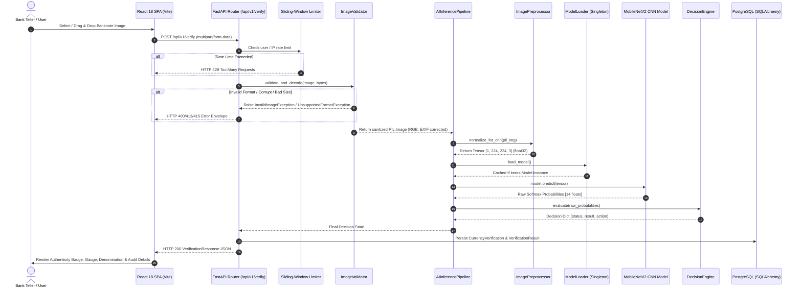

# NoteGuard AI — End-to-End Architecture Audit

**Date**: August 16, 2026  
**Auditor**: Senior Machine Learning Engineer & System Architect  
**Audit Mode**: Read-Only Forensic Analysis  

---

## 1. Request Lifecycle Flowchart

---

## 2. Step-by-Step Architectural Pipeline Breakdown

| Step | Component / Module | Exact Function / Class | Input Data & Type | Output Data & Type | Transformation Description | Failure Modes & Error Handling |
| :--- | :--- | :--- | :--- | :--- | :--- | :--- |
| **1. UI Image Selection** | `frontend/src/pages/VerifyPage.tsx` | `handleFileSelect` | User selected file object | `File` (image/jpeg, png) | UI client-side MIME & size pre-check. | User drops non-image file $\rightarrow$ frontend rejection. |
| **2. HTTP Transport** | `frontend/src/core/api/client.ts` | `apiClient.post('/verify')` | `FormData` with `image_front` | HTTP POST payload | Encapsulates binary multipart boundary. | Network drop $\rightarrow$ Axios retry / timeout. |
| **3. Rate Limiting** | `backend/src/core/security/rate_limit.py` | `verify_rate_limiter` | Client IP / Token string | `bool` / Dependency pass | Evaluates sliding window in-memory timestamps. | Rate limit exceeded $\rightarrow$ HTTP 429 JSON response. |
| **4. Ingestion & Validation** | `backend/src/modules/ai_engine/validation.py` | `ImageValidator.validate_and_decode()` | Raw `bytes` ($10\text{KB} - 10\text{MB}$) | `PIL.Image.Image` (RGB) | Magic bytes check, format check (JPEG, PNG), dimension check ($\ge 100\times 100$), EXIF transposition. | Corrupted image $\rightarrow$ `InvalidImageException` (HTTP 400). |
| **5. Preprocessing & Tensorization** | `backend/src/modules/ai_engine/preprocessing.py` | `ImagePreprocessor.normalize_for_cnn()` | `PIL.Image.Image` | `np.ndarray` $[1, 224, 224, 3]$ (`float32`) | Nearest-neighbor resize to $(224, 224)$, conversion to `np.float32`, batch dimension expansion. | Memory allocation failure $\rightarrow$ `InferenceException`. |
| **6. Thread-Safe Model Loading** | `backend/src/modules/ai_engine/loaders.py` | `ModelLoader.load_model()` | `model_path: str` | `tf.keras.Model` | Lazy singleton double-checked locking load. | File not found $\rightarrow$ `ModelLoadException` (HTTP 500). |
| **7. CNN Forward Pass** | `backend/src/modules/ai_engine/inference.py` | `AIInferenceService.execute_prediction()` | `np.ndarray` $[1, 224, 224, 3]$ | `dict` containing label, confidence, $P(\text{real})$, $P(\text{fake})$, vector | Model execution with thread lock. Computes class index and aggregate binary scores. | TF internal runtime fault $\rightarrow$ `InferenceException`. |
| **8. Decision Engine** | `backend/src/modules/ai_engine/decision.py` | `DecisionEngine.evaluate()` | Raw prediction dictionary | `dict` conforming to `VerificationResponse` | Threshold enforcement ($0.80$ cutoff), aggregate authenticity check, ₹2000 demonetization policy. | Low confidence $\rightarrow$ returns `UNABLE_TO_DETERMINE`. |
| **9. Audit Persistence** | `backend/src/modules/ai_engine/router.py` | `verify_image()` DB block | SQLAlchemy `Session`, Result dict | Database Rows (`CurrencyVerification`, `VerificationResult`) | Persists verification attempt, scores, verdict, and timestamp in PostgreSQL. | DB transaction error $\rightarrow$ rolled back, logged via `structlog`. |
| **10. UI Result Presentation** | `frontend/src/components/motion/result-reveal.tsx` | `ResultReveal` component | `VerificationResponse` JSON | Rendered DOM Tree | Renders authenticity badge, denomination display, confidence gauge, and reason alert. | Malformed JSON response $\rightarrow$ error toast. |
