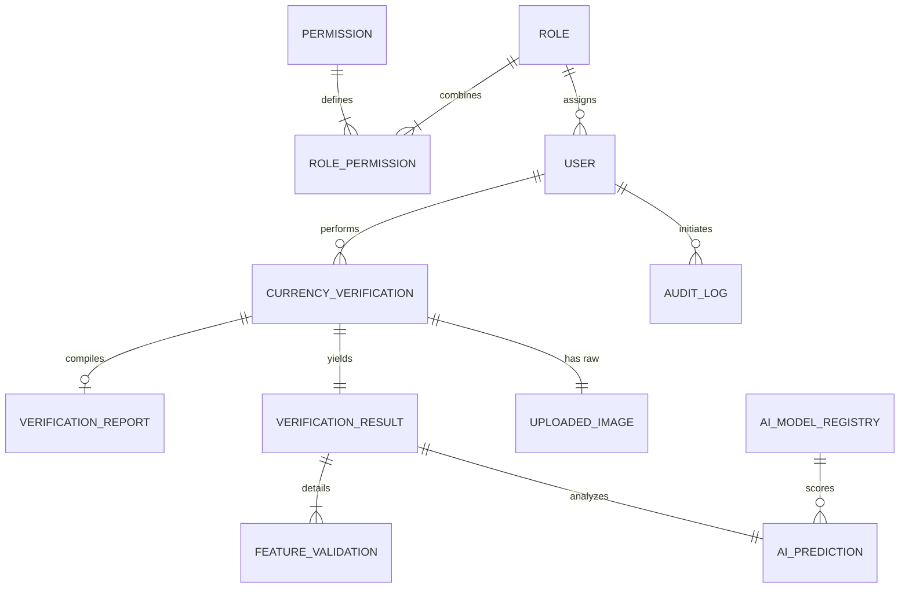

# NoteGuard AI - Domain Model & Database Design

This document details the Domain Model and Database Design for **NoteGuard AI**. It bridges functional business domains with a physical PostgreSQL database structure, specifying entity structures, constraints, partition boundaries, performance indexes, and security patterns.

---

## 1. Domain Model

The core entities that drive the business capabilities of NoteGuard AI are defined below.

### 1.1 Core Entities

#### 1. User
*   **Purpose**: Represents any authenticated individual or agent interacting with the system.
*   **Responsibilities**: Authentication, session binding, tracking authorization contexts.
*   **Attributes**: ID (UUID), Username (string), Password Hash (string), Email (string), Status (Active/Suspended), Last Login Time (timestamp).
*   **Relationships**: 
    *   Many-to-One with **Role**.
    *   One-to-Many with **CurrencyVerification** (scans submitted by this user).
*   **Ownership**: System administration ownership.
*   **Lifecycle**: Created $\rightarrow$ Verified $\rightarrow$ Active $\leftrightarrow$ Suspended $\rightarrow$ Archived.

#### 2. Role & Permission
*   **Purpose**: Manages access boundaries inside the application.
*   **Responsibilities**: Mapping users to authorization contexts.
*   **Attributes**: ID (UUID), Name (string), Description (string), Key (string).
*   **Relationships**: 
    *   One-to-Many with **User**.
    *   Many-to-Many with **Permission** (via joining table).
*   **Ownership**: Security system configuration.
*   **Lifecycle**: Static/immutable bootstrap states with custom modifications by Admin.

#### 3. CurrencyVerification (Scan)
*   **Purpose**: Represents a single request to verify a note.
*   **Responsibilities**: Orchestrates the transaction state, binds image inputs to verification results, and logs the user who initiated the request.
*   **Attributes**: ID (UUID), Status (Pending/Processing/Completed/Failed), Created At (timestamp).
*   **Relationships**:
    *   Many-to-One with **User** (ownership/audit).
    *   One-to-One with **UploadedImage** (composition).
    *   One-to-One with **VerificationResult** (composition).
    *   One-to-One with **VerificationReport** (aggregation).
*   **Ownership**: Owned by the executing user.
*   **Lifecycle**: Created $\rightarrow$ Preprocessed $\rightarrow$ Classifying $\rightarrow$ Features Verifying $\rightarrow$ Completed / Failed.

#### 4. UploadedImage
*   **Purpose**: Tracks metadata for uploaded files stored in S3/Object storage.
*   **Responsibilities**: Resolving storage locations and verifying upload file integrity.
*   **Attributes**: ID (UUID), Storage URL (string), File Size (bytes), SHA-256 Checksum (string), Resolution Width (int), Resolution Height (int), MIME Type (string).
*   **Relationships**:
    *   One-to-One with **CurrencyVerification** (belongs to a scan).
*   **Ownership**: Composed within **CurrencyVerification**.
*   **Lifecycle**: Uploaded $\rightarrow$ Validated $\rightarrow$ Processed $\rightarrow$ Archived (when scan history is purged).

#### 5. VerificationResult
*   **Purpose**: The central verdict of an authentication transaction.
*   **Responsibilities**: Calculating final validation states, aggregating weighted confidence scores, and indicating counterfeit categories.
*   **Attributes**: ID (UUID), Is Authentic (boolean), Overall Confidence Score (decimal), System Verdict (Enum: Authentic / Counterfeit / Suspicious), Verdict Reason (string).
*   **Relationships**:
    *   One-to-One with **CurrencyVerification** (belongs to a scan).
    *   One-to-Many with **FeatureValidation** (composition).
    *   One-to-One with **AIPrediction** (composition).
*   **Ownership**: Composed within **CurrencyVerification**.
*   **Lifecycle**: Draft $\rightarrow$ Evaluating $\rightarrow$ Finalized $\rightarrow$ Locked.

#### 6. AIPrediction
*   **Purpose**: Logs the prediction output of the base CNN model.
*   **Responsibilities**: Recording denomination class predictions, note orientation, and base confidence values.
*   **Attributes**: ID (UUID), Denomination (int), Orientation (Enum: Front / Back), Confidence Score (decimal), Inference Time MS (int).
*   **Relationships**:
    *   One-to-One with **VerificationResult** (belongs to a result).
    *   Many-to-One with **AIModelRegistry** (tracks which model version generated the prediction).
*   **Ownership**: Owned by the executing system engine.
*   **Lifecycle**: Generated $\rightarrow$ Logged.

#### 7. FeatureValidation
*   **Purpose**: Logs security check results evaluated by verification plugins.
*   **Responsibilities**: Recording details of specific features (watermark, thread, Ashoka pillar).
*   **Attributes**: ID (UUID), Feature Name (string), Is Authentic (boolean), Feature Confidence Score (decimal), ROI Coordinates (JSON), Crop Storage URL (string), Plugin Metadata (JSON).
*   **Relationships**:
    *   Many-to-One with **VerificationResult** (belongs to a parent result).
*   **Ownership**: Composed within **VerificationResult**.
*   **Lifecycle**: Generated $\rightarrow$ Logged.

#### 8. VerificationReport
*   **Purpose**: Tracks PDF reports generated for authentication events.
*   **Responsibilities**: Serving exportable PDF documents for compliance or police filings.
*   **Attributes**: ID (UUID), Storage URL (string), Generated At (timestamp), Report Status (Pending / Completed / Failed).
*   **Relationships**:
    *   One-to-One with **CurrencyVerification** (belongs to a scan).
*   **Ownership**: Aggregated within **CurrencyVerification**.
*   **Lifecycle**: Queued $\rightarrow$ Compiling $\rightarrow$ Completed $\rightarrow$ Archived.

#### 9. AIModelRegistry
*   **Purpose**: Tracks machine learning models and version weights.
*   **Responsibilities**: Loading active model structures and verifying checksum files.
*   **Attributes**: ID (UUID), Model Name (string), Model Version (string), Storage URL (string), Is Active (boolean), SHA-256 Checksum (string), Threshold Configuration (JSON).
*   **Relationships**:
    *   One-to-Many with **AIPrediction** (logs references).
*   **Ownership**: Managed by System Admin.
*   **Lifecycle**: Uploaded $\rightarrow$ Staged $\rightarrow$ Active $\leftrightarrow$ Inactive $\rightarrow$ Deprecated.

#### 10. AuditLog
*   **Purpose**: Low-level compliance log tracking of user and admin actions.
*   **Responsibilities**: Maintaining read-only logs of critical operations.
*   **Attributes**: ID (UUID), Actor User ID (UUID), Action Type (string), IP Address (string), User Agent (string), Timestamp (timestamp), Payload (JSON).
*   **Relationships**:
    *   Many-to-One with **User** (actor).
*   **Ownership**: System infrastructure.
*   **Lifecycle**: Immutable insertion $\rightarrow$ Retained $\rightarrow$ Purged after retention window.

#### 11. SystemConfiguration
*   **Purpose**: Stores dynamic configuration parameters.
*   **Responsibilities**: Exposing thresholds, API limits, and rate limits to the application.
*   **Attributes**: Config Key (string, PK), Config Value (string), Description (string).
*   **Relationships**: None (Standalone global lookup table).
*   **Ownership**: Managed by System Admin.
*   **Lifecycle**: Active $\rightarrow$ Modified.

---

## 2. Domain Relationships (ERD)

---

## 3. PostgreSQL Database Design (Logical Specification)

All tables include:
- `id`: `UUID` (Primary Key, default to `gen_random_uuid()`).
- `created_at` / `updated_at`: `TIMESTAMPTZ` (default `now()`).
- `created_by` / `updated_by`: `UUID` (Foreign Keys referencing `users.id`, nullable where system-generated).

### 3.1 Table Schema Definitions

#### 1. Table: `roles`
Stores role configuration definitions.
*   **Columns**:
    *   `id`: `UUID` (PK, NOT NULL)
    *   `name`: `VARCHAR(50)` (NOT NULL, UNIQUE, e.g. "Teller")
    *   `key`: `VARCHAR(50)` (NOT NULL, UNIQUE, e.g. "ROLE_TELLER")
    *   `description`: `VARCHAR(255)` (NULLABLE)
    *   `created_at`: `TIMESTAMPTZ` (NOT NULL, DEFAULT `now()`)
    *   `updated_at`: `TIMESTAMPTZ` (NOT NULL, DEFAULT `now()`)
*   **Constraints**: None.
*   **Indexes**: Unique index on `key`.

#### 2. Table: `permissions`
Stores fine-grained action keys.
*   **Columns**:
    *   `id`: `UUID` (PK, NOT NULL)
    *   `key`: `VARCHAR(100)` (NOT NULL, UNIQUE, e.g. "permission:verify_currency")
    *   `description`: `VARCHAR(255)` (NULLABLE)
    *   `created_at`: `TIMESTAMPTZ` (NOT NULL, DEFAULT `now()`)
    *   `updated_at`: `TIMESTAMPTZ` (NOT NULL, DEFAULT `now()`)
*   **Indexes**: Unique index on `key`.

#### 3. Table: `role_permissions`
Join table mapping roles to permissions (Many-to-Many).
*   **Columns**:
    *   `role_id`: `UUID` (PK/FK referencing `roles.id`, ON DELETE CASCADE, NOT NULL)
    *   `permission_id`: `UUID` (PK/FK referencing `permissions.id`, ON DELETE CASCADE, NOT NULL)
*   **Indexes**: Composite PK index on `(role_id, permission_id)`.

#### 4. Table: `users`
Stores user profile records.
*   **Columns**:
    *   `id`: `UUID` (PK, NOT NULL)
    *   `username`: `VARCHAR(100)` (NOT NULL, UNIQUE)
    *   `password_hash`: `VARCHAR(255)` (NOT NULL)
    *   `email`: `VARCHAR(255)` (NOT NULL, UNIQUE)
    *   `role_id`: `UUID` (FK referencing `roles.id`, ON DELETE RESTRICT, NOT NULL)
    *   `status`: `VARCHAR(20)` (NOT NULL, CHECK `status IN ('active', 'suspended', 'archived')`)
    *   `created_at`: `TIMESTAMPTZ` (NOT NULL, DEFAULT `now()`)
    *   `updated_at`: `TIMESTAMPTZ` (NOT NULL, DEFAULT `now()`)
    *   `created_by`: `UUID` (FK referencing `users.id`, NULLABLE)
    *   `updated_by`: `UUID` (FK referencing `users.id`, NULLABLE)
*   **Indexes**: 
    *   B-Tree index on `username`.
    *   B-Tree index on `email`.

#### 5. Table: `currency_verifications` (PARTITIONED)
Stores parent transaction entities. This table is partitioned by range on `created_at` (see Performance section).
*   **Columns**:
    *   `id`: `UUID` (PK, NOT NULL)
    *   `user_id`: `UUID` (FK referencing `users.id`, ON DELETE RESTRICT, NOT NULL)
    *   `status`: `VARCHAR(20)` (NOT NULL, CHECK `status IN ('pending', 'processing', 'completed', 'failed')`)
    *   `created_at`: `TIMESTAMPTZ` (PK, NOT NULL, DEFAULT `now()`)
    *   `updated_at`: `TIMESTAMPTZ` (NOT NULL, DEFAULT `now()`)
*   **Indexes**:
    *   B-Tree index on `(user_id, created_at)`.

#### 6. Table: `uploaded_images` (PARTITIONED)
Stores raw image storage targets. This table is partitioned by range on `created_at` to match parent partition structure.
*   **Columns**:
    *   `id`: `UUID` (PK, NOT NULL)
    *   `verification_id`: `UUID` (FK referencing `currency_verifications.id`, ON DELETE CASCADE, NOT NULL)
    *   `storage_url`: `VARCHAR(512)` (NOT NULL)
    *   `file_size_bytes`: `BIGINT` (NOT NULL)
    *   `sha256_checksum`: `CHAR(64)` (NOT NULL)
    *   `resolution_width`: `INTEGER` (NOT NULL)
    *   `resolution_height`: `INTEGER` (NOT NULL)
    *   `mime_type`: `VARCHAR(50)` (NOT NULL)
    *   `created_at`: `TIMESTAMPTZ` (PK, NOT NULL, DEFAULT `now()`)
    *   `updated_at`: `TIMESTAMPTZ` (NOT NULL, DEFAULT `now()`)
*   **Indexes**:
    *   B-Tree index on `verification_id`.

#### 7. Table: `ai_model_registry`
Stores versioned weights registry for deep learning models.
*   **Columns**:
    *   `id`: `UUID` (PK, NOT NULL)
    *   `model_name`: `VARCHAR(100)` (NOT NULL)
    *   `model_version`: `VARCHAR(50)` (NOT NULL)
    *   `storage_url`: `VARCHAR(512)` (NOT NULL)
    *   `sha256_checksum`: `CHAR(64)` (NOT NULL)
    *   `is_active`: `BOOLEAN` (NOT NULL, DEFAULT FALSE)
    *   `threshold_config`: `JSONB` (NOT NULL)
    *   `created_at`: `TIMESTAMPTZ` (NOT NULL, DEFAULT `now()`)
    *   `updated_at`: `TIMESTAMPTZ` (NOT NULL, DEFAULT `now()`)
    *   `created_by`: `UUID` (FK referencing `users.id`, NULLABLE)
    *   `updated_by`: `UUID` (FK referencing `users.id`, NULLABLE)
*   **Constraints**:
    *   Unique constraint on `(model_name, model_version)`.

#### 8. Table: `verification_results` (PARTITIONED)
Stores validation verdicts. Partitioned by range on `created_at`.
*   **Columns**:
    *   `id`: `UUID` (PK, NOT NULL)
    *   `verification_id`: `UUID` (FK referencing `currency_verifications.id`, ON DELETE CASCADE, NOT NULL)
    *   `is_authentic`: `BOOLEAN` (NOT NULL)
    *   `confidence_score`: `NUMERIC(5,4)` (NOT NULL, CHECK `confidence_score >= 0 AND confidence_score <= 1`)
    *   `system_verdict`: `VARCHAR(20)` (NOT NULL, CHECK `system_verdict IN ('authentic', 'counterfeit', 'suspicious')`)
    *   `verdict_reason`: `VARCHAR(255)` (NULLABLE)
    *   `created_at`: `TIMESTAMPTZ` (PK, NOT NULL, DEFAULT `now()`)
    *   `updated_at`: `TIMESTAMPTZ` (NOT NULL, DEFAULT `now()`)
*   **Indexes**:
    *   B-Tree index on `verification_id`.
    *   B-Tree index on `system_verdict`.

#### 9. Table: `ai_predictions` (PARTITIONED)
Stores predictions generated by the base CNN. Partitioned by range on `created_at`.
*   **Columns**:
    *   `id`: `UUID` (PK, NOT NULL)
    *   `verification_result_id`: `UUID` (FK referencing `verification_results.id`, ON DELETE CASCADE, NOT NULL)
    *   `model_id`: `UUID` (FK referencing `ai_model_registry.id`, ON DELETE RESTRICT, NOT NULL)
    *   `predicted_denomination`: `INTEGER` (NOT NULL)
    *   `predicted_orientation`: `VARCHAR(10)` (NOT NULL, CHECK `predicted_orientation IN ('front', 'back')`)
    *   `confidence_score`: `NUMERIC(5,4)` (NOT NULL, CHECK `confidence_score >= 0 AND confidence_score <= 1`)
    *   `inference_time_ms`: `INTEGER` (NOT NULL)
    *   `created_at`: `TIMESTAMPTZ` (PK, NOT NULL, DEFAULT `now()`)
*   **Indexes**:
    *   B-Tree index on `verification_result_id`.

#### 10. Table: `feature_validations` (PARTITIONED)
Stores validation details for individual features checked by plugins. Partitioned by range on `created_at`.
*   **Columns**:
    *   `id`: `UUID` (PK, NOT NULL)
    *   `verification_result_id`: `UUID` (FK referencing `verification_results.id`, ON DELETE CASCADE, NOT NULL)
    *   `feature_name`: `VARCHAR(50)` (NOT NULL)
    *   `is_authentic`: `BOOLEAN` (NOT NULL)
    *   `confidence_score`: `NUMERIC(5,4)` (NOT NULL, CHECK `confidence_score >= 0 AND confidence_score <= 1`)
    *   `crop_image_url`: `VARCHAR(512)` (NOT NULL)
    *   `roi_coordinates`: `JSONB` (NOT NULL)
    *   `plugin_metadata`: `JSONB` (NOT NULL)
    *   `created_at`: `TIMESTAMPTZ` (PK, NOT NULL, DEFAULT `now()`)
*   **Indexes**:
    *   B-Tree index on `verification_result_id`.
    *   B-Tree index on `(feature_name, is_authentic)`.

#### 11. Table: `verification_reports` (PARTITIONED)
Stores generated verification report metadata. Partitioned by range on `created_at`.
*   **Columns**:
    *   `id`: `UUID` (PK, NOT NULL)
    *   `verification_id`: `UUID` (FK referencing `currency_verifications.id`, ON DELETE CASCADE, NOT NULL)
    *   `storage_url`: `VARCHAR(512)` (NULLABLE)
    *   `report_status`: `VARCHAR(20)` (NOT NULL, CHECK `report_status IN ('pending', 'completed', 'failed')`)
    *   `created_at`: `TIMESTAMPTZ` (PK, NOT NULL, DEFAULT `now()`)
    *   `updated_at`: `TIMESTAMPTZ` (NOT NULL, DEFAULT `now()`)
*   **Indexes**:
    *   B-Tree index on `verification_id`.

#### 12. Table: `audit_logs` (PARTITIONED)
Stores low-level action logs. Partitioned by range on `created_at`.
*   **Columns**:
    *   `id`: `UUID` (PK, NOT NULL)
    *   `actor_user_id`: `UUID` (FK referencing `users.id`, ON DELETE SET NULL, NULLABLE)
    *   `action_type`: `VARCHAR(100)` (NOT NULL, e.g. "USER_LOGIN_SUCCESS")
    *   `ip_address`: `VARCHAR(45)` (NOT NULL)
    *   `user_agent`: `VARCHAR(255)` (NULLABLE)
    *   `payload`: `JSONB` (NULLABLE)
    *   `created_at`: `TIMESTAMPTZ` (PK, NOT NULL, DEFAULT `now()`)
*   **Indexes**:
    *   B-Tree index on `(actor_user_id, created_at)`.
    *   B-Tree index on `(action_type, created_at)`.

#### 13. Table: `system_configurations`
Stores global config key-value parameters.
*   **Columns**:
    *   `config_key`: `VARCHAR(100)` (PK, NOT NULL)
    *   `config_value`: `TEXT` (NOT NULL)
    *   `description`: `VARCHAR(255)` (NULLABLE)
    *   `updated_at`: `TIMESTAMPTZ` (NOT NULL, DEFAULT `now()`)
    *   `updated_by`: `UUID` (FK referencing `users.id`, NULLABLE)

---

## 4. Performance Design (Enterprise Scaling)

### 4.1 Table Partitioning Plan
High-throughput verification apps log massive audit histories. To prevent query degradation, write-heavy tables (`currency_verifications`, `uploaded_images`, `verification_results`, `ai_predictions`, `feature_validations`, `verification_reports`, `audit_logs`) will use **PostgreSQL Declarative Range Partitioning** based on the `created_at` column.

*   **Partition Boundaries**: Monthly partitions.
*   **Retention Scheme**:
    *   *Hot Tier*: Current month + previous 3 months kept locally inside the main PostgreSQL cluster.
    *   *Warm Tier*: Months 4–12. Partitions are detached and moved to secondary read-only table spaces on cheaper EBS volumes.
    *   *Cold Tier*: Logs older than 1 year are dumped to compressed CSV file archives and uploaded to S3 storage, then the partitions are dropped.

### 4.2 Indexing Strategy
*   **Composite Indexing**: 
    *   `currency_verifications(user_id, created_at)`: Accelerates history queries filtering by teller ID sorted by date.
    *   `feature_validations(feature_name, is_authentic)`: Enhances analytics aggregations (e.g. tracking failure rates for watermarks).
*   **Partial/Filtered Indexing**:
    *   Create a partial index on `verification_results(system_verdict)` where `system_verdict IN ('counterfeit', 'suspicious')` to quickly locate bad transactions without parsing millions of valid scans.
*   **JSONB Indexing (GIN)**:
    *   Create a GIN index on `feature_validations(plugin_metadata)` to allow index-accelerated querying of internal plugin metrics.

---

## 5. Security & Isolation Architecture

### 5.1 RBAC Enforcement
SQL access is managed through dedicated role accounts:
- `noteguard_app_role`: Read/Write access to functional scan, user, and config tables. Blocked from directly running administrative schema changes.
- `noteguard_analytics_role`: Read-only access to history and validation tables. Denied access to sensitive profile columns (like `password_hash`).

### 5.2 Encryption Guidelines
- **Encryption at Rest**: AWS RDS storage instances must be encrypted using AWS KMS keys.
- **Sensitive Fields**: Passwords must be hashed using `bcrypt` with a minimum cost factor of 12.
- **Image URLs & Signatures**: S3 raw and cropped image URLs must not be publicly readable. URLs stored in the database represent private paths. The application generates **AWS S3 Presigned URLs** with an expiration time of 10 minutes when rendering verification results to authorized clients.

### 5.3 Soft Delete Strategy
Entities like `users` and `ai_model_registry` must never be deleted using raw `DELETE` SQL operations. They include a `status` or active flag.
- When deleted, the system changes the status to `'suspended'` or `'archived'`, rendering them inactive in standard user query views.
- Deep relational entities (such as scans) are preserved to maintain compliance history.

---

## 6. Naming Conventions

To ensure consistent database design, the database layout enforces these naming rules:

*   **Table Names**: lowercase plural separated by underscores (`snake_case`, e.g. `currency_verifications`, `uploaded_images`).
*   **Primary Keys**: Named `id` (UUID format).
*   **Foreign Keys**: Column name follows singular target reference table name appended with `_id` (e.g., `user_id`, `role_id`). Constraint names follow format `fk_<source_table>_<target_table>` (e.g., `fk_users_roles`).
*   **Index Names**: Format `idx_<table_name>_<columns>` (e.g., `idx_users_username`). Unique indexes use prefix `ux_` instead of `idx_`.
*   **Boolean Columns**: Prefixed with `is_` (e.g., `is_authentic`, `is_active`).
*   **Timestamp Columns**: Appended with `_at` and configured with timezone (`TIMESTAMPTZ`, e.g., `created_at`, `updated_at`).
