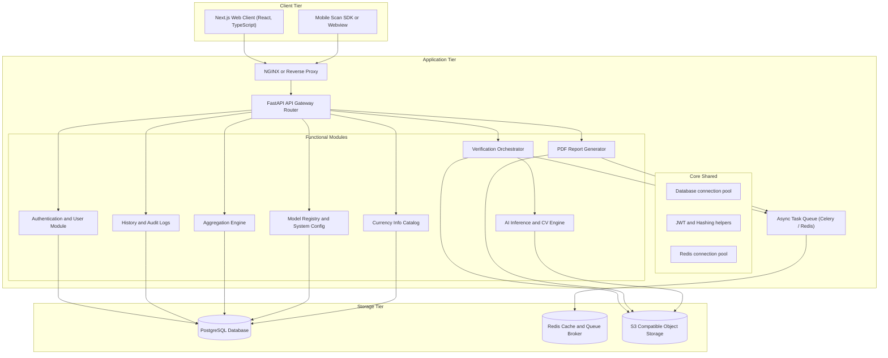
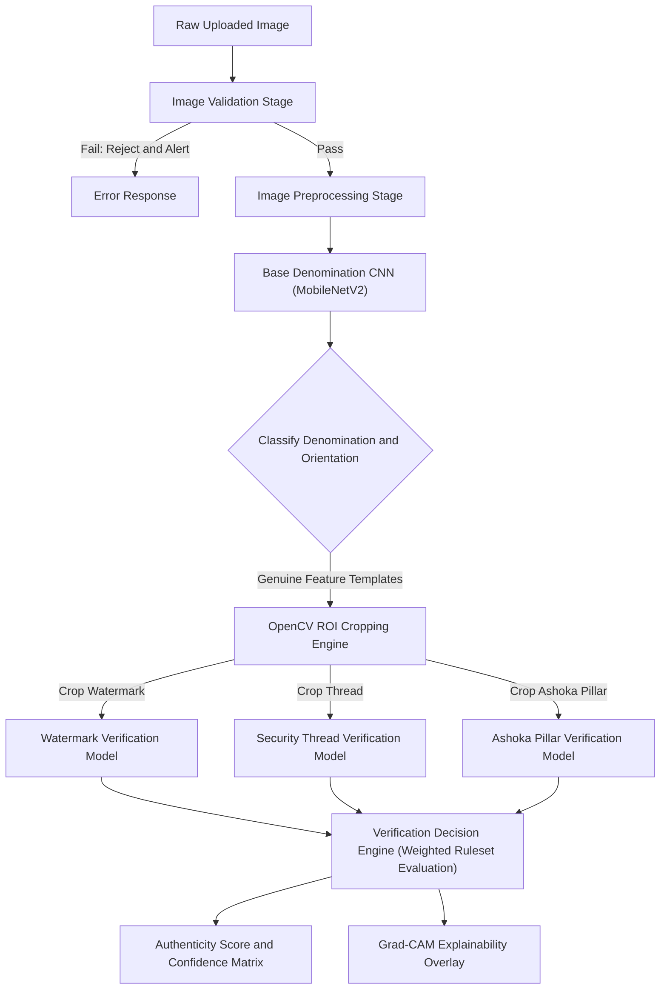

# NoteGuard AI - High-Level Design (HLD)

This document specifies the High-Level Design (HLD) for **NoteGuard AI**, an enterprise-grade, AI-powered currency authentication platform. It outlines the modular monolith structure, domain-level communication, AI processing flow, security configurations, deployment topology, storage schemas, and directory layouts to guide implementation.

---

## 1. Overall System Architecture

The NoteGuard AI platform is structured as a **Modular Monolith** to balance high-speed development and simplified deployments with robust boundaries between modules. This allows individual modules to be refactored or extracted into microservices in the future if scale dictates.



---

## 2. Complete Module Architecture & Responsibilities

### Module Boundary Definitions

| Module | Core Responsibility | Key Components |
| :--- | :--- | :--- |
| **Shared / Core** | Cross-cutting concerns, database adapters, shared error types, middleware, and config loading. | Database connection pool, custom exception handlers, logger. |
| **Authentication & User** | Validates user identities, issues tokens, manages User records, and implements RBAC. | JWT provider, bcrypt password hasher, RBAC middleware. |
| **Currency Verification** | Orchestrates the validation and inference flow of uploaded images. Runs the rules engine. | Upload handlers, verification routing, verification state machine. |
| **AI Inference & CV** | Preprocesses images, runs inference models, Crops regions of interest, and generates explainability overlays. | OpenCV preprocessing pipeline, TensorFlow/ONNX wrapper, Grad-CAM generator. |
| **Verification History** | Records and indexes audit entries for scans. Provides history querying interfaces. | History repository, indexer service. |
| **Reports Module** | Generates official PDF verification summaries asynchronously. | Report generator (Weasyprint/ReportLab), PDF templates, S3 PDF uploader. |
| **Analytics Module** | Runs time-series data aggregation for dashboards and generates counterfeit anomaly alerts. | Aggregators, dashboard query service. |
| **Currency Info Catalog** | Stores and serves detailed references regarding genuine notes (dimensions, features, watermarks). | Catalog controller, safety feature database. |
| **Admin Module** | Manages classification thresholds, system variables, and registers/swaps active AI model weights. | Model registry manager, configuration controllers. |

---

## 3. Communication Flow

To preserve the independence of modules inside the modular monolith, the codebase will adhere to the following communication rules:
1. **Direct Imports Restricted**: Modules may only reference other modules through clear, interface-defined Services or local API interfaces. 
2. **Synchronous REST-like Communication**: Modules can query other modules using typed, local interface methods (e.g. dependency injection parameters) rather than raw HTTP calls to minimize performance overhead.
3. **Asynchronous Messaging**: For resource-intensive workloads (generating reports, processing logs), the initiating module publishes an event to an in-memory event bus or a Redis-backed queue. The executing module (e.g. Reports Module) listens to this queue, runs the task asynchronously, and updates the database state upon completion.

---

## 4. AI Verification Subsystem Architecture

The core value proposition of NoteGuard AI lies in its hybrid Computer Vision and Deep Learning pipeline:



### Process Step Definitions

1. **Image Validation**
   - **Quality Check**: Computes the Laplacian variance to reject blurry photos.
   - **Luminance Check**: Analyzes histograms to reject extremely dark/bright photos.
   - **Aspect Ratio Check**: Asserts standard currency aspect ratios within predefined tolerances.
2. **Image Preprocessing**
   - **Deskewing & Alignment**: Detects currency boundaries using OpenCV Canny Edge / Hough Transform and applies affine transformations to rotate and crop the note.
   - **Normalization**: Resizes images to standard CNN input dimensions (e.g. $224 \times 224$ or $448 \times 448$) and normalizes pixel distributions.
3. **Denomination Detection**
   - MobileNetV2 executes to classify the base denomination (`10, 20, 50, 100, 200, 500, 2000 INR`) and the side of the note (Front/Back).
4. **ROI Cropping Engine**
   - Based on the identified denomination and orientation, coordinate templates map the coordinates of key security features. OpenCV crops sub-images (e.g., Mahatma Gandhi watermark, Ashoka Pillar, security thread).
5. **Feature-Level Evaluation**
   - Cropped sub-images are passed to specialized classification networks or compared against authentic references using Structural Similarity Index Measure (SSIM) and local feature matching (ORB/SIFT).
6. **Verification Decision Engine**
   - Evaluates scores from multiple zones. If the thread is correct but the watermark fails, the system outputs a detailed failure analysis rather than a simple binary flag.
7. **Explainability Overlay (Grad-CAM)**
   - Computes gradients from the final convolutional layer of the base model to highlight the spatial focus regions, illustrating why the model marked a note as counterfeit (e.g., lack of proper structure in the watermark region).

---

## 5. Storage Architecture

```
                               ┌────────────────────────────────┐
                               │     NoteGuard Storage Hub      │
                               └────────────────────────────────┘
                                                │
                 ┌──────────────────────────────┼──────────────────────────────┐
                 ▼                              ▼                              ▼
    ┌──────────────────────────┐  ┌──────────────────────────┐  ┌──────────────────────────┐
    │       PostgreSQL         │  │      Object Storage      │  │        Redis Cache       │
    ├──────────────────────────┤  ├──────────────────────────┤  ├──────────────────────────┤
    │ • User Accounts          │  │ • Raw Currency Uploads   │  │ • JWT Access Sessions    │
    │ • RBAC Schema            │  │ • Cropped ROI Images     │  │ • Rate-Limiting Counters │
    │ • Scan Audit Logs        │  │ • Verification Reports   │  │ • Task Queues (Celery)   │
    │ • Analytics Summaries    │  │ • Registered Model Files │  │ • Warm Config Profiles   │
    └──────────────────────────┘  └──────────────────────────┘  └──────────────────────────┘
```

- **Database (PostgreSQL)**: Handles relational data, including `users`, `scans`, `scan_results`, `reports`, `audit_logs`, and system configuration configurations. PostgreSQL ensures ACID transactions for audits and enables complex aggregation queries for the analytics engine.
- **Object Storage (S3-compatible, e.g. MinIO/AWS S3)**: Hosts bulky unstructured files. Paths to raw uploads, cropped feature snapshots, models, and PDF reports are saved in PostgreSQL as external links.
- **Cache (Redis)**: Speeds up session state retrieval, enforces API rate limits, and acts as the messaging broker for asynchronous background workers.

---

## 6. Security Architecture

- **Authentication**: Stateless JWT-based authentication. Access tokens have short lifetimes (e.g. 15 minutes) with secure HTTP-only cookie-based refresh tokens.
- **Authorization & RBAC**: Every route check is bound to a strict Role hierarchy:
  - `ROLE_USER` (Individual / Student): Can only initiate scans and view their personal scan history.
  - `ROLE_TELLER` (Retail / Bank employee): Can scan currency, trigger verification reports, and view branch histories.
  - `ROLE_MANAGER` (Vault Manager): Access to branch analytics, user performance statistics, and manual review overrides.
  - `ROLE_ADMIN` (System Admin): Full access to platform parameters, system logs, model registry updates, and user management.
- **Secure File Uploads**: 
  - Restricts uploads to MIME-type verified formats (`image/jpeg`, `image/png`, `image/webp`).
  - Limits file size to 10MB to mitigate denial of service (DoS) vectors.
  - Generates unique UUID filenames on storage, stripping original client-supplied filenames.
- **API Protection**:
  - Employs Redis-based token-bucket rate limiting on inference endpoints.
  - Implements CORS policies restricting origin access to authorized client domains.

---

## 7. Folder Architecture

The folder design mirrors the modular monolith structure, cleanly isolating domains inside both the frontend and backend.

### Backend Structure (FastAPI)
```
backend/
├── alembic/                    # Database migration scripts
├── src/
│   ├── main.py                 # FastAPI application entry point
│   ├── config.py               # Application configurations (Pydantic-based)
│   ├── core/                   # Shared module for cross-cutting code
│   │   ├── database.py         # DB session, engine setup
│   │   ├── security.py         # Hashing, JWT implementation
│   │   ├── exceptions.py       # Base HTTP exception handler declarations
│   │   ├── middleware.py       # Rate limiting, logging, and CORS middlewares
│   │   └── storage.py          # S3/MinIO abstraction client
│   └── modules/                # Monolithic module boundaries
│       ├── auth/               # User Authentication module
│       │   ├── routes.py       # HTTP routes
│       │   ├── services.py     # Domain logic (registration, login)
│       │   ├── models.py       # SQL Alchemy database tables
│       │   └── schemas.py      # Pydantic schemas (requests/responses)
│       ├── verification/       # Verification orchestrator
│       │   ├── routes.py
│       │   ├── services.py     # Execution orchestration pipeline
│       │   ├── rules.py        # Authenticity scoring threshold engine
│       │   ├── models.py
│       │   └── schemas.py
│       ├── ai_engine/          # Computer Vision & TensorFlow module
│       │   ├── pipeline.py     # Preprocessing & CV orchestration
│       │   ├── models/         # Local folder cache for model binaries
│       │   ├── loaders.py      # Model weight loading, warm start execution
│       │   ├── inference.py    # TensorFlow/ONNX session wrapper execution
│       │   └── utils/          # OpenCV helpers (align, crop, deskew)
│       ├── history/            # Verification Audit log module
│       │   ├── routes.py
│       │   ├── services.py
│       │   └── models.py
│       ├── reports/            # PDF Generation module
│       │   ├── services.py     # Asynchronous PDF compilation logic
│       │   └── templates/      # PDF HTML/CSS formats
│       └── analytics/          # Data aggregate calculations
│           ├── routes.py
│           └── services.py     # Dashboard aggregation logic
└── tests/                      # Pytest automated test suites
```

### Frontend Structure (Next.js App Router)
```
frontend/
├── public/                     # Static media files and typography
├── src/
│   ├── app/                    # Next.js App Router root
│   │   ├── layout.tsx          # Root container (Context providers, Theme)
│   │   ├── page.tsx            # Landing Page
│   │   ├── login/              # Login routes
│   │   ├── dashboard/          # Aggregated dashboard UI
│   │   │   ├── page.tsx
│   │   │   └── analytics/      # Analytics sub-view
│   │   ├── verify/             # Interactive scan workspace
│   │   ├── history/            # Audit logs view
│   │   └── admin/              # Admin configurations
│   ├── components/             # Reusable UI component catalog
│   │   ├── ui/                 # Atomic design tokens (Buttons, Cards, Inputs)
│   │   ├── charts/             # Custom chart components (Recharts wrappers)
│   │   └── verification/       # ROI crop previews, scanning feedback cards
│   ├── core/                   # Core client logic
│   │   ├── api/                # HTTP clients configured with JWT refresh handling
│   │   ├── hooks/              # Custom shared hooks (useAuth, useScans)
│   │   └── utils/              # Client-side formatting helpers
│   └── styles/
│       └── globals.css         # Base stylesheet
```

---

## 8. Deployment Architecture

NoteGuard AI is containerized for production consistency and deployed in a load-balanced cloud context.

```
                              [ Public Traffic ]
                                      │
                                      ▼
                        ┌──────────────────────────┐
                        │   SSL Termination / LB   │
                        └──────────────────────────┘
                                      │
                 ┌────────────────────┴────────────────────┐
                 ▼                                         ▼
    ┌──────────────────────────┐              ┌──────────────────────────┐
    │    FastAPI Instance 1    │              │    FastAPI Instance 2    │
    │  (Web Monolith Pod - K8s)│              │  (Web Monolith Pod - K8s)│
    └──────────────────────────┘              └──────────────────────────┘
           │             │                           │             │
           │             └─────────────┬─────────────┘             │
           ▼                           ▼                           ▼
    ┌─────────────┐             ┌─────────────┐             ┌─────────────┐
    │ Redis Cache │             │   Celery    │             │ PostgreSQL  │
    │  & Broker   │             │ Worker Pods │             │  Database   │
    └─────────────┘             └─────────────┘             └─────────────┘
                                       │                           │
                                       ▼                           ▼
                                ┌─────────────┐             ┌─────────────┐
                                │ S3-Object   │             │ Replication │
                                │   Storage   │             │ Read Replica│
                                └─────────────┘             └─────────────┘
```

- **Load Balancer (e.g. AWS ALB / NGINX Ingress)**: Terminates SSL/TLS certificates and distributes external traffic evenly across backend replica endpoints.
- **Web App Replicas**: Multiple Kubernetes pods running containerized instances of the FastAPI modular monolith.
- **Asynchronous Task Workers (Celery/RQ)**: Dedicated worker containers scale independently to process long-running PDF report creations, model warm-ups, or batch log jobs, offloading CPU-intensive ML tasks from the HTTP thread pool.
- **Database Topology**: Managed PostgreSQL (e.g. AWS RDS) deployed with Multi-AZ replication to ensure continuous availability, coupled with Read Replicas dedicated to handling heavy analytical queries.

---

## 9. Technology Justification

| Layer | Chosen Technology | Architectural Rationale |
| :--- | :--- | :--- |
| **Backend API** | **FastAPI (Python)** | Eliminates the performance overhead of traditional Python frameworks (Django/Flask) using asynchronous event loops (`async/await`). Its native integration with Python's ecosystem allows it to call TensorFlow, ONNX, and OpenCV directly in the same memory space, avoiding out-of-process serialization latencies. |
| **Frontend UI** | **Next.js (React / TS)** | Delivers high-performance, SEO-optimized, server-side rendered interfaces. TypeScript provides compile-time safety across type interfaces mapped from API schemas, which is crucial for handling complex currency analysis matrices. |
| **AI Inference** | **TensorFlow / ONNX** | TensorFlow is selected to utilize pretrained `MobileNetV2` models. Transitioning model files to ONNX Runtime in production can yield significant execution speedups on standard CPU monolith pods, minimizing expensive GPU requirements. |
| **Task Broker** | **Redis** | Chosen for its low latency as an in-memory database. Serves three critical tasks simultaneously: fast session management, token-bucket API rate limits, and asynchronous task delivery to worker processes. |
| **Database** | **PostgreSQL** | Relational schemas are critical to enforcing structural referential integrity on audit trails and verification accounts. It is robust, supports spatial indexes if location analytics are required, and handles concurrent connections under load safely. |
| **CV Pipeline** | **OpenCV** | Industry-standard toolkit for high-performance computer vision tasks. Enables deskewing, coordinate projection transformations, and cropping regions of interest (ROI) inside the same memory loop. |
| **Report Engine**| **Weasyprint / ReportLab** | Compiles HTML/CSS layouts into print-ready PDF formats, avoiding complex formatting loops and allowing styling of analytics outputs. |
