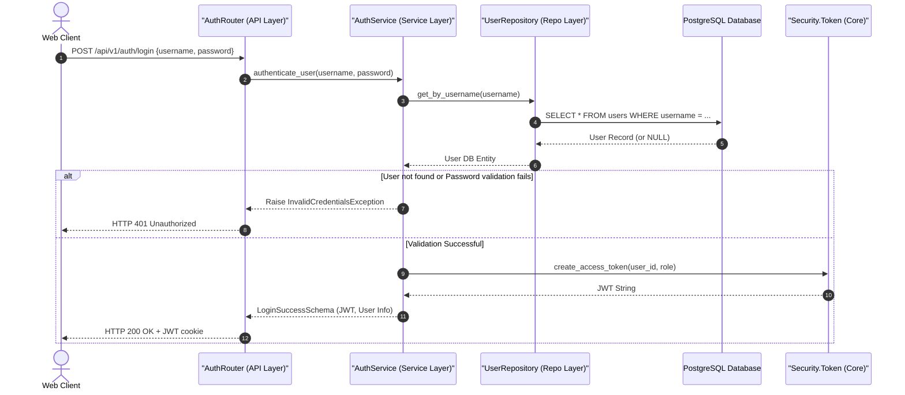
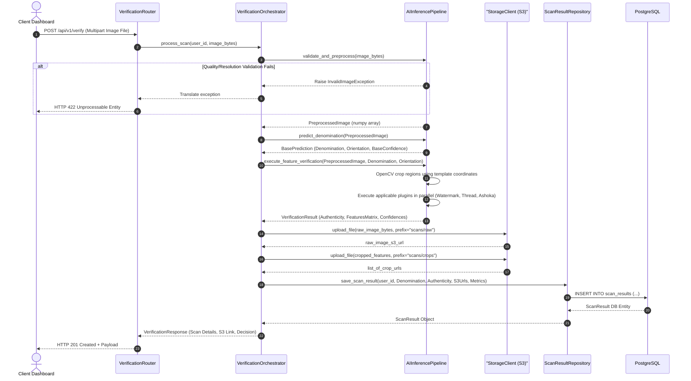
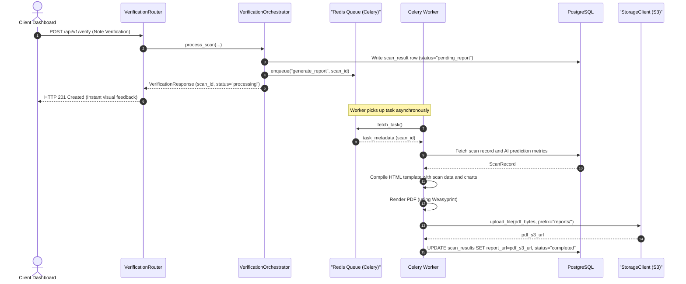

# NoteGuard AI - Low-Level Design (LLD)

This document specifies the Low-Level Design (LLD) for **NoteGuard AI**. It details the software abstractions, interfaces, data layers, class structures, execution sequences, and coding guidelines needed to implement the platform.

---

## 1. Directory & Package Structure

This section defines the file-level blueprint of the application. The project is separated into a Next.js (TypeScript) client and a FastAPI (Python) server.

### 1.1 Backend Package Layout (FastAPI)
```
backend/
├── src/
│   ├── main.py                     # App initialisation, middleware binding, and event hooks
│   ├── config.py                   # Pydantic Settings class parsing environment variables
│   ├── core/                       # Core shared capabilities (no functional module dependencies)
│   │   ├── database/
│   │   │   ├── connection.py       # SQLAlchemy engine and sessionmaker config
│   │   │   └── base_model.py       # Declarative base model containing shared columns (created_at, updated_at)
│   │   ├── security/
│   │   │   ├── password.py         # Bcrypt hashing abstraction
│   │   │   └── token.py            # JWT encoding, decoding, and validation
│   │   ├── storage/
│   │   │   ├── client.py           # Base S3 client wrapper
│   │   │   └── exceptions.py       # Custom storage connection exception definitions
│   │   ├── exceptions/
│   │   │   ├── base.py             # DomainException base class
│   │   │   └── handlers.py         # Global Exception mapping to standard JSON API error responses
│   │   └── logging/
│   │       └── logger.py           # Structured JSON logger setup
│   └── modules/                    # Self-contained business domains (modules)
│       ├── auth/
│       │   ├── router.py           # Auth API route definitions
│       │   ├── services.py         # AuthenticationService interface and implementation
│       │   ├── repositories.py     # UserRepository interfacing Database
│       │   ├── models.py           # User database schema definitions
│       │   └── schemas.py          # User Pydantic request/response models
│       ├── verification/
│       │   ├── router.py           # Scan submission route handlers
│       │   ├── services.py         # VerificationOrchestrator implementation
│       │   ├── rules/
│       │   │   ├── evaluator.py    # VerificationRulesEvaluator class
│       │   │   └── schemas.py      # Threshold configuration parameters
│       │   ├── repositories.py     # ScanResultRepository
│       │   ├── models.py           # Scan database schemas
│       │   └── schemas.py          # Scan execution request/response models
│       ├── ai_engine/
│       │   ├── pipeline.py         # AIInferencePipeline coordinator
│       │   ├── loaders.py          # ModelLoader manager
│       │   ├── validation.py       # ImageValidator class (Laplacian variance, brightness)
│       │   ├── preprocessing.py    # ImagePreprocessor class (deskew, resize, normalize)
│       │   ├── detection.py        # DenominationDetector (MobileNetV2 classifier wrapper)
│       │   ├── plugins/
│       │   │   ├── base.py         # IVerificationPlugin interface definition
│       │   │   ├── factory.py      # VerificationPluginFactory registry
│       │   │   ├── watermark.py    # WatermarkVerificationPlugin implementation
│       │   │   ├── thread.py       # SecurityThreadVerificationPlugin implementation
│       │   │   ├── ashoka.py       # AshokaPillarVerificationPlugin implementation
│       │   │   └── microtext.py    # MicroTextVerificationPlugin implementation
│       │   └── schemas.py          # Structured prediction definitions
│       ├── history/
│       │   ├── router.py           # History query routes
│       │   ├── services.py         # HistoryQueryService implementation
│       │   └── repositories.py     # Read-only Auditing/History repos
│       ├── reports/
│       │   ├── services.py         # ReportGenerator implementation
│       │   ├── worker.py           # Celery background report task loops
│       │   └── templates/
│       │       └── report.html     # HTML design template for PDF rendering
│       └── analytics/
│           ├── router.py           # Analytics aggregate API endpoints
│           ├── services.py         # AggregatorService implementation
│           └── repositories.py     # Analytics aggregation database helpers
└── tests/
    ├── conftest.py                 # Pytest fixtures (DB transaction setup, mock clients)
    ├── unit/                       # Pure unit tests (isolated module logic)
    └── integration/                # Module boundary and pipeline integration tests
```

### 1.2 Frontend Package Layout (Next.js)
```
frontend/
├── src/
│   ├── app/                        # Next.js App Router folders
│   │   ├── layout.tsx              # Root HTML setup, React-Query & Theme context wraps
│   │   ├── page.tsx                # Public Landing Page
│   │   ├── login/
│   │   │   └── page.tsx            # Login panel layout
│   │   ├── dashboard/
│   │   │   ├── layout.tsx          # Collapsible navigation drawer layout
│   │   │   ├── page.tsx            # Analytics Overview View
│   │   │   ├── scans/
│   │   │   │   └── page.tsx        # Audit logs history page
│   │   │   └── verify/
│   │   │       └── page.tsx        # Interactive scanner workbench
│   │   └── admin/
│   │       └── page.tsx            # Model configuration console
│   ├── components/                 # UI components
│   │   ├── ui/                     # Design tokens (Button, Card, Alert, Modal)
│   │   ├── charts/                 # Visual data components (Recharts configurations)
│   │   └── verification/           # Scanner feed, ROI crop overlay highlights
│   ├── core/                       # Client libraries
│   │   ├── api/
│   │   │   ├── client.ts           # Axios client instances configured with interceptors
│   │   │   └── endpoints.ts        # Typed API mappings
│   │   ├── hooks/
│   │   │   ├── useAuth.ts          # Authentication state management
│   │   │   └── useVerify.ts        # Scan submission handler hook
│   │   └── types/
│   │       └── api.d.ts            # Shared API payload type contracts
│   └── styles/
│       └── globals.css             # Vanilla CSS core definitions (tokens, base resets)
```

---

## 2. Layered Architecture Pattern

To guarantee separation of concerns, the backend enforces a clean **Layered Architecture**. Data flows down through layers; layers are only aware of their immediate downstream layer.

```
┌────────────────────────────────────────────────────────┐
│                   Presentation Layer                   │
│          (Web Dashboard, Mobile App UI)                │
└───────────────────────────┬────────────────────────────┘
                            │ (JSON over HTTP REST)
                            ▼
┌────────────────────────────────────────────────────────┐
│                       API Layer                        │
│            (FastAPI Routers, Request Validation)       │
└───────────────────────────┬────────────────────────────┘
                            │ (Pydantic Schemas)
                            ▼
┌────────────────────────────────────────────────────────┐
│                     Service Layer                      │
│             (Domain Logic, Orchestration)              │
└─────────────┬─────────────┬─────────────┬──────────────┘
              │             │             │
              ▼             ▼             ▼
┌───────────────────────┐ ┌───────────────────────┐ ┌───────────────────────┐
│   Repository Layer    │ │   AI Engine Layer     │ │   Shared Utilities    │
│  (SQLAlchemy, Postgres)│ │ (CV Pipelines, CNNs)  │ │   (Crypto, S3, Logs)  │
└───────────────────────┘ └───────────────────────┘ └───────────────────────┘
```

1.  **Presentation Layer**: The Next.js frontend application. Collects files and metadata, displays results, and handles styling.
2.  **API Layer**: FastAPI routes. Decodes HTTP payloads, validates structural constraints via Pydantic schemas, routes requests, and translates internal exceptions into correct HTTP status codes.
3.  **Service Layer**: The core of the system. Implements business logic, transaction control, validation checks, and delegates database or model workflows.
4.  **Repository Layer**: Encapsulates all data access logic. Contains SQL queries, database connections, and mappings. Controllers never execute database interactions directly.
5.  **AI Engine Layer**: Runs the machine learning models and computer vision pipelines (OpenCV / TensorFlow). This is kept separate from the service layer so that models can be run independently of the database.
6.  **Shared Utilities**: Helper files for common tasks (e.g. S3 uploads, password hashing, system logging).

---

## 3. Module Dependency & Interaction Rules

To avoid dependency creep inside the modular monolith, the system enforces the following strict rules:

```
                            ┌────────────────┐
                            │  Shared/Core   │
                            └───────▲────────┘
                                    │ (Import Allowed)
         ┌──────────────────────────┼──────────────────────────┐
         │                          │                          │
┌────────┴────────┐        ┌────────┴────────┐        ┌────────┴────────┐
│  Auth Module    │        │  Verify Module  │        │ Analytics Mod.  │
└─────────────────┘        └────────┬────────┘        └────────┬────────┘
                                    │                          │
                                    ▼                          ▼
                           ┌────────────────┐         ┌────────────────┐
                           │   AI Engine    │         │  History Mod.  │
                           └────────────────┘         └────────────────┘
```

1.  **Shared Module Dependency**: All functional modules may depend on `core/` classes (such as connection pools, base exceptions, logging structures). The `core/` module is not allowed to import from any functional modules.
2.  **Unidirectional Boundary Access**:
    *   The `Verification` module can invoke the `AI Engine` and the `History` modules.
    *   The `AI Engine` module is standalone. It is not allowed to import from `Verification`, `History`, or any other functional module.
    *   The `Analytics` module is read-only. It reads data via the `History` and `Verification` repositories.
3.  **Circular Import Rejection**: Circular imports (e.g. `Verification` importing `Reports` and `Reports` importing `Verification`) are strictly prohibited and will fail static lint checks. If two modules must communicate bidirectionally, they must use the `Core Shared` event broker or interface adapters.

---

## 4. AI Verification Engine (Plugin-Based Architecture)

To allow adding new features (like microtext checking or watermarks) without changing the core engine, the AI engine is structured as a **Plugin-Based Architecture** using the **Strategy** and **Factory** design patterns.

### 4.1 Interface Specification (`IVerificationPlugin`)

Every verification plugin must inherit from the `IVerificationPlugin` abstract base class:

```python
import abc
import numpy as np
from pydantic import BaseModel

class PluginVerificationResult(BaseModel):
    feature_name: str
    is_authentic: bool
    confidence: float
    metadata: dict  # Contains validation metrics, localized coords, SSIM etc.

class IVerificationPlugin(abc.ABC):
    @abc.abstractproperty
    def plugin_id(self) -> str:
        """Returns unique identifier for the plugin (e.g. 'watermark_checker')."""
        pass

    @abc.abstractproperty
    def required_denomination(self) -> list[int]:
        """List of denomination values this check is applicable to (e.g., [500, 2000])."""
        pass

    @abc.abstractmethod
    def verify(self, cropped_image: np.ndarray, denomination: int, metadata: dict) -> PluginVerificationResult:
        """Executes the specific feature classification or structural check."""
        pass
```

### 4.2 Factory & Registry System (`VerificationPluginFactory`)

```python
class VerificationPluginFactory:
    _registry: dict[str, IVerificationPlugin] = {}

    @classmethod
    def register(cls, plugin: IVerificationPlugin):
        cls._registry[plugin.plugin_id] = plugin

    @classmethod
    def get_plugin(cls, plugin_id: str) -> IVerificationPlugin:
        if plugin_id not in cls._registry:
            raise ValueError(f"Plugin {plugin_id} not registered.")
        return cls._registry[plugin_id]

    @classmethod
    def get_applicable_plugins(cls, denomination: int) -> list[IVerificationPlugin]:
        """Returns all plugins configured for a specific denomination."""
        return [
            plugin for plugin in cls._registry.values()
            if denomination in plugin.required_denomination
        ]
```

### 4.3 Engine Structure & Core Orchestration

The orchestrator executes the processing pipeline:

```
[Normalized Image]
       │
       ▼
┌───────────────────────────────────────────────┐
│     Denomination & Orientation Detector      │
│  • Identifies Denomination (e.g., 500 INR)     │
│  • Identifies Orientation (e.g., Front)       │
└──────────────────────┬────────────────────────┘
                       │
                       ▼
┌───────────────────────────────────────────────┐
│         OpenCV ROI Cropping Engine            │
│  • Loads coordinate template for 500-Front    │
│  • Crops regions for Watermark, Thread, etc.  │
└──────────────────────┬────────────────────────┘
                       │
             ┌─────────┴─────────┐ (Parallel Processing)
             ▼                   ▼
    ┌─────────────────┐ ┌─────────────────┐
    │ WatermarkPlugin │ │  ThreadPlugin   │ ...[Other Plugins]
    └────────┬────────┘ └────────┬────────┘
             │                   │
             └─────────┬─────────┘
                       │ (Aggregates Results)
                       ▼
┌───────────────────────────────────────────────┐
│              Confidence Engine                │
│  • Calculates final authenticity decision     │
│  • Computes weighted confidence score         │
└───────────────────────────────────────────────┘
```

---

## 5. System Execution Sequences

### 5.1 User Login Flow
This diagram details password checking and token generation using JWT.



### 5.2 Currency Verification Pipeline
This diagram tracks the main verification flow, including OpenCV processing, base CNN classification, plugin execution, database saving, and object storage.



### 5.3 Asynchronous Report Generation Flow
This diagram maps out how verification reports are generated asynchronously to keep the main web servers responsive.



---

## 6. Database Schema Design (Physical Implementation Details)

The database schema is structured for auditing, role access, and analytics tracking.

```
                  ┌──────────────────────┐
                  │        users         │
                  ├──────────────────────┤
                  │ PK  id               │
                  │     username         │
                  │     password_hash    │
                  │     role (enum)      │
                  │     created_at       │
                  └──────────┬───────────┘
                             │ 1
                             │
                             │ 0..*
                  ┌──────────▼───────────┐
                  │     scan_results     │
                  ├──────────────────────┤
                  │ PK  id               │
                  │ FK  user_id          │
                  │     denomination     │
                  │     is_authentic     │
                  │     confidence_score │
                  │     raw_image_url    │
                  │     report_url       │
                  │     status (enum)    │
                  │     created_at       │
                  └──────────┬───────────┘
                             │ 1
                             │
                             │ 0..*
                  ┌──────────▼───────────┐
                  │  feature_validations │
                  ├──────────────────────┤
                  │ PK  id               │
                  │ FK  scan_id          │
                  │     feature_name     │
                  │     is_authentic     │
                  │     confidence_score │
                  │     crop_image_url   │
                  │     metadata (json)  │
                  └──────────────────────┘
```

### Table Definitions (Domb-level DDL equivalents)

1.  **users**
    *   `id`: `UUID` (Primary Key, Default: `uuid_generate_v4()`)
    *   `username`: `VARCHAR(100)` (Unique, Indexed)
    *   `password_hash`: `VARCHAR(255)`
    *   `role`: `VARCHAR(20)` (Constraint: `'ROLE_USER', 'ROLE_TELLER', 'ROLE_MANAGER', 'ROLE_ADMIN'`)
    *   `created_at`: `TIMESTAMP WITH TIME ZONE`
2.  **scan_results**
    *   `id`: `UUID` (Primary Key)
    *   `user_id`: `UUID` (Foreign Key referencing `users.id`, Indexed)
    *   `denomination`: `INTEGER`
    *   `is_authentic`: `BOOLEAN`
    *   `confidence_score`: `NUMERIC(5, 4)`
    *   `raw_image_url`: `VARCHAR(512)`
    *   `report_url`: `VARCHAR(512)` (Nullable)
    *   `status`: `VARCHAR(20)` (Constraint: `'pending', 'processing', 'completed', 'failed'`)
    *   `created_at`: `TIMESTAMP WITH TIME ZONE` (Indexed)
3.  **feature_validations**
    *   `id`: `UUID` (Primary Key)
    *   `scan_id`: `UUID` (Foreign Key referencing `scan_results.id`, Cascade Delete)
    *   `feature_name`: `VARCHAR(50)` (e.g. `'watermark'`, `'security_thread'`)
    *   `is_authentic`: `BOOLEAN`
    *   `confidence_score`: `NUMERIC(5, 4)`
    *   `crop_image_url`: `VARCHAR(512)`
    *   `metadata`: `JSONB` (Stores model execution metrics, coordinates, etc.)

---

## 7. Cross-Cutting Design Strategies

### 7.1 Exception Handling Strategy
The system uses custom domain-level exceptions mapped to standardized API responses at the border.

```
                         ┌───────────────────────┐
                         │   DomainException     │
                         │   (Base Exception)    │
                         └───────────┬───────────┘
                                     │
             ┌───────────────────────┼───────────────────────┐
             ▼                       ▼                       ▼
┌─────────────────────────┐ ┌─────────────────────────┐ ┌─────────────────────────┐
│ InvalidCredentialsExc.  │ │  VerificationFailedExc. │ │   StorageFailedExc.     │
│  (Auth Module, 401)     │ │  (Verify Module, 422)   │ │  (Core Module, 503)     │
└─────────────────────────┘ └─────────────────────────┘ └─────────────────────────┘
```

*   **Global Exception Middleware**: A FastAPI custom exception handler catches all exceptions inheriting from `DomainException`. It translates them into standard JSON responses:
    ```json
    {
      "status_code": 422,
      "error_code": "INVALID_IMAGE_RESOLUTION",
      "message": "Uploaded image resolution is too low. Required minimum is 1080p.",
      "timestamp": "2026-08-05T09:03:00Z"
    }
    ```
*   **Database Rollbacks**: Middleware monitors HTTP transactions. If an unhandled exception or a `DomainException` occurs, the current database session calls `.rollback()` to ensure database consistency.

### 7.2 Logging Strategy
*   **Structured Logging**: NoteGuard AI uses structured JSON logging via the Python `structlog` library. Raw string prints (`print()`) are prohibited.
*   **Context Injection**: The log format includes the transaction context on every line (e.g. `user_id`, `scan_id`, `ip_address`).
*   **Audit Trailing**: Critical actions (such as user logins, configuration modifications, and verification decisions) are flagged with the tag `"AUDIT": true` to export them to security and compliance aggregators.

---

## 8. Coding Standards & Naming Conventions

### 8.1 Python / Backend Standards
*   **Classes**: UpperCamelCase (e.g. `VerificationOrchestrator`, `UserRepository`).
*   **Variables, Functions & Methods**: snake_case (e.g. `process_scan()`, `get_by_id()`).
*   **Constants**: UPPERCASE_SNAKE_CASE (e.g. `MAX_UPLOAD_SIZE_BYTES`).
*   **Type Hinting**: All functions must declare input and return types (e.g. `def verify(self, image: np.ndarray) -> VerificationResult:`).

### 8.2 TypeScript / Frontend Standards
*   **Components & Layouts**: UpperCamelCase (e.g. `VerificationPanel.tsx`).
*   **Hooks**: camelCase starting with `use` (e.g. `useVerification.ts`).
*   **Utilities, Methods, Types**: camelCase (e.g. `formatDate()`, `fetchScanDetails()`).
*   **Interfaces**: camelCase beginning with `I` (e.g. `IScanResultProps`).

### 8.3 Interface Injection Rules
*   **Dependency Injection**: All repositories, database sessions, and services are injected into FastAPI routers via FastAPI's `Depends` dependencies. Hardcoded service instantiations inside routes are forbidden.
*   **Environment Configuration**: Configurations must use Pydantic `BaseSettings` classes. Accessing `os.environ` directly in codebase sub-modules is not permitted.
