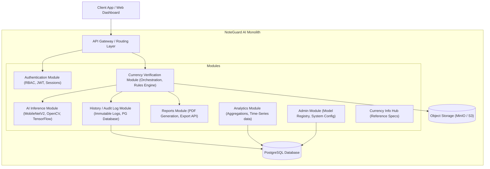
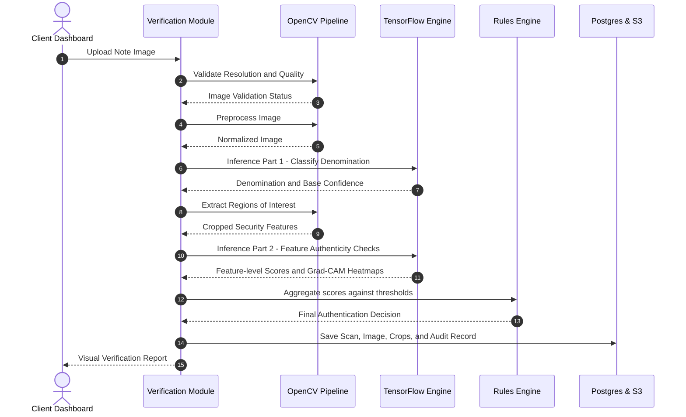

# NoteGuard AI - Architectural Blueprint & Project Understanding

This document establishes the strategic, architectural, and operational understanding of **NoteGuard AI** as a production-grade, enterprise-ready AI-powered currency authentication platform. It outlines the modular monolith structure, AI processing pipeline, user experience vision, and identifies key technical questions that must be resolved before implementation.

---

## 1. Product Vision & Enterprise Positioning

Unlike academic models that stop at outputting a binary classification, **NoteGuard AI** is conceived as a secure, auditable, and scalable fintech platform tailored for banks, retailers, and cash counters. 

### Core Pillars
- **Zero-Trust Verification**: Move beyond single-point classification to multi-feature authentication (comparing global note composition against micro-cropped security features).
- **Auditability**: Maintain an immutable history of every verification attempt, enabling forensic tracebacks of counterfeit distribution patterns.
- **Enterprise-Grade UI/UX**: Deliver a dashboard inspired by Stripe and OpenAI—sleek, fast, information-dense, and highly visual.
- **Scalability**: Implement a modular monolith design that allows independent evolution of domain logic without the overhead of microservices.

---

## 2. Modular Monolith Architecture

The system will be organized as a **Modular Monolith**. Each business domain is treated as a self-contained module with its own domain logic, data models, and service interfaces, residing within a single codebase.

### Module Boundary Definitions

1. **Authentication (Auth)**
   - Role-Based Access Control (RBAC): Tellers (scan only), Vault Managers (scan, review reports, view analytics), System Admins (configure model thresholds, system parameters).
2. **Currency Verification**
   - Orchestrates the verification lifecycle. Receives the image, passes it to the AI Inference module, validates results against business rules, and saves records.
3. **AI Inference Engine**
   - Handles image preprocessing, model execution (MobileNetV2 classification), and feature localization. Keep distinct from web routers to allow swapping runtime engines (e.g. CPU vs. GPU, local vs. cloud API).
4. **History & Audit Logs**
   - Records every verification attempt. Stores input image metadata, cropped segments, validation scores, and reviewer overrides.
5. **Analytics & Dashboards**
   - Computes aggregated metrics: counterfeit velocity, total processed volume, distribution of detected denominations, and model error rates.
6. **Reports Generator**
   - Asynchronously creates PDF audit reports for flagged counterfeit bills (including Grad-CAM heatmaps, cropped features, and metadata) to support compliance/police filing.
7. **Admin Control Panel**
   - Configures classification thresholds, enables/disables specific security check rules, and uploads new model weights.
8. **Currency Information Hub**
   - Houses structural information on valid denominations (dimensions, watermarks, security thread types) to serve as reference materials for users.

---

## 3. End-to-End AI & Verification Flow

To achieve high precision, the AI pipeline goes beyond a single image-level classification, utilizing a sequential, multi-stage pipeline:

### Stage Breakdown

*   **Image Validation**: Checks if the uploaded image has sufficient lighting, is not excessively blurry (Laplacian variance check), and actually resembles a currency note (initial boundary detection).
*   **Image Preprocessing**: Deskewing, rotation correction, and resizing.
*   **Classification & Localisation**: The base MobileNetV2 model determines denomination (e.g., 500 INR) and orientation. OpenCV or a secondary object detection model localizes key security regions (e.g., security thread, Mahatma Gandhi portrait watermark, Ashoka Pillar).
*   **Cropped Feature Inference**: Compares extracted ROIs against known authentic patterns.
*   **Verification Engine**: Evaluates scores from multiple zones. If the thread is correct but the watermark fails, the system outputs a detailed failure analysis rather than a simple binary flag.

---

## 4. Key Architectural Clarification Questions

To ensure the platform design aligns with your business goals, we need to address these architectural questions:

### Q1: Dataset Structure & Cropped Feature Strategy
We have the dataset of real/fake full notes and cropped security feature images. 
- *How are they labeled and linked?* Are the cropped images explicitly annotated with bounding box coordinates relative to the full notes, or are they separate datasets designed for independent classifiers?
- *Should we train a multi-headed network* (one model classifying denomination, and separate subnetworks verifying individual cropped features), or a cascade of independent models?

### Q2: Edge vs. Cloud Deployment Strategy
- *Where will the inference run?* MobileNetV2 is optimized for edge devices. Do you intend to deploy the AI inference directly on-device (client-side in web/mobile app using TensorFlow.js / TFLite) or centralize it in the backend (Python TensorFlow service)?
- Centralized server inference allows for more robust analytics, audit logging, and protects the proprietary model weights, whereas edge inference reduces latency and server costs.

### Q3: OCR & Serial Number Tracking
- Indian currency has a unique alphanumeric serial number printed with changing font sizes. While OCR is marked for "future versions", should the database and UI *immediately support* a schema that accepts serial numbers to prevent double-scan frauds (i.e. scanning the same authentic note multiple times to spoof transactions, or tracing identical counterfeit serials)?

### Q4: Dual-Sided Scanning Requirements
- Essential security features of Indian currency are distributed across both the front (e.g., security thread, Mahatma Gandhi portrait, latent image) and back (e.g., Swachh Bharat logo, year of printing, language panel).
- Does the system require the user to upload both the front and back of the note to complete verification, or can it operate on a single-sided upload with reduced confidence?

---

## 5. Identified Gaps & Missing Requirements

1. **System Latency SLA**: High-throughput cash counters require sub-second processing. We need to define the target response time (e.g., < 800ms) for the entire pipeline (validation + denomination + feature crops + database writes).
2. **Out-of-Distribution (OOD) Rejection**: If a user uploads a blank page or a non-currency image, a pure classifier will still force a prediction with some confidence. We need a strict "Not a Currency Note" class or anomaly detection threshold to reject non-currency immediately.
3. **Adversarial / "Super Note" Handling**: High-quality counterfeits ("Super Notes") might bypass standard global CNNs. The system must support manual review overrides, allowing banking admins to mark a predicted "Real" note as "Fake" after physical inspection, which triggers model retraining loops.
4. **Geographical Counterfeit Mapping**: To make analytics valuable for banks and law enforcement, recording the location (or IP/branch office ID) of the scanning device is necessary to map counterfeit outbreaks.
