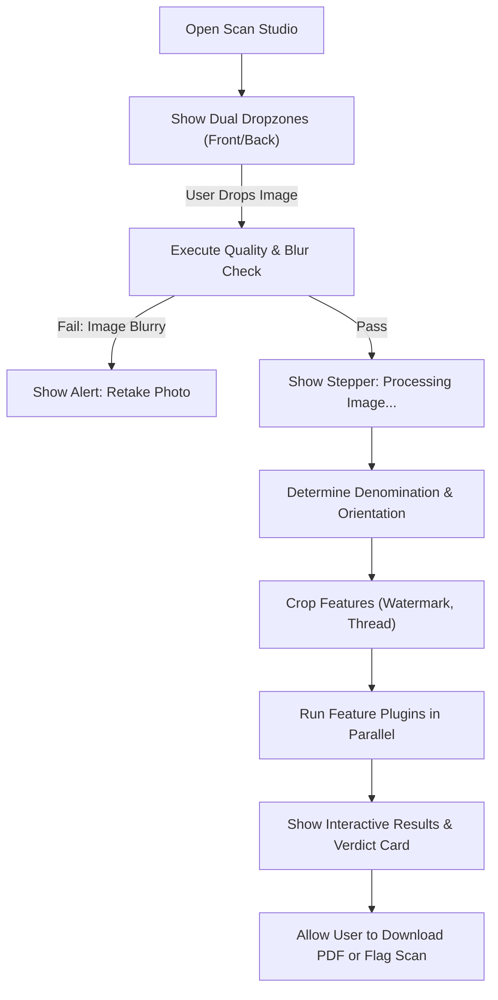
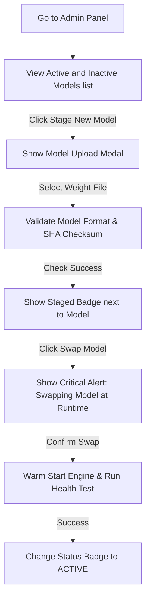

# NoteGuard AI - UI/UX Architecture

This document specifies the complete User Experience and User Interface Architecture for **NoteGuard AI**. It bridges complex AI verification results with an intuitive, premium, and auditable enterprise console.

---

## 1. Information Architecture (Sitemap)

The navigation tree enforces structural boundaries between user actions (scanning, browsing history, reviewing system reports) and administrative configurations.

```
NoteGuard Console Root
├── (Public) Landing Page
├── Authentication (Login, Password Reset)
├── (Authenticated Workspace) Sidebar Navigation
│   ├── Dashboard (Overview, Quick Actions)
│   ├── Verify Note (Interactive Dual-Sided Scan Studio)
│   ├── Verification History (Searchable Audit Database)
│   ├── Reports Catalog (PDF Download Center)
│   ├── Analytics Center (Branch Performance, Counterfeit Anomaly Tracking)
│   ├── Currency Library (Reference Banknotes Information)
│   ├── Admin Settings (System Config, Model Swaps, Role Assignments)
│   └── User Settings (Profile, Security Keys)
```

---

## 2. Design System Tokens (Stripe / GitHub Style)

To deliver a premium, high-density interface, NoteGuard AI utilizes a clean, border-focused design language.

### 2.1 Color Palette

```
  Primary Dark Background:  #0B0E14  (HSL 220, 15%, 8%)
  Card/Surface Background: #121820  (HSL 220, 15%, 12%)
  Border Level 1:          #1F2937  (HSL 220, 15%, 20%)
  Text Primary:            #F9FAFB  (HSL 0, 0%, 98%)
  Text Secondary:          #9CA3AF  (HSL 220, 10%, 65%)
  
  Genuine Green:           #10B981  (HSL 142, 70%, 45%)
  Counterfeit Red:         #EF4444  (HSL 0, 84%, 60%)
  Suspicious Amber:        #F59E0B  (HSL 35, 92%, 55%)
  Information Blue:        #3B82F6  (HSL 217, 91%, 60%)
```

### 2.2 Typography
*   **Primary Font Family**: `Inter, system-ui, sans-serif` (for UI controls, cards, layouts).
*   **Headings**: `Outfit, sans-serif` (geometric, modern, high aesthetic).
*   **Data/Code/UUIDs**: `JetBrains Mono, monospace` (for scan IDs, checksum hashes, serial numbers).

### 2.3 Spacing Scale
The system uses a strict 8px grid system to maintain alignment:
`4px (xs) | 8px (sm) | 16px (md) | 24px (lg) | 32px (xl) | 64px (2xl)`

---

## 3. Screen Inventory & Wireframe Layouts

### 3.1 Authentication Screen (Login)
*   **Purpose**: Multi-tenant secure entry portal.
*   **Layout**: Split Screen.
    *   *Left Column (45% Width)*: Visual branding panel, showcasing a running 3D mock UI preview of the verification flow.
    *   *Right Column (55% Width)*: Centered login form containing username field, password field, "Remember Device" checkbox, and a primary button labeled "Authenticate Session".
*   **States**:
    *   *Loading*: Form opacity drops to 60%; login button changes to progress indicator spinner.
    *   *Error*: Red alert banner slides down from form header with error code: `INVALID_CREDENTIALS`.

---

### 3.2 Main Dashboard Workspace
*   **Purpose**: Central operational hub containing performance data, system metrics, and quick action launch pads.
*   **Layout**: 3-Column Grid.
    *   *Sidebar Navigation (Left, 240px)*: High-density list containing section navigation keys, user session indicator, and Active Model Version badge (`TFL-MN2-V1.4`).
    *   *Primary Workspace (Center, Fluid)*: 
        *   Row 1: Header title ("System Overview") with date selector.
        *   Row 2: Four KPI Metric Cards (Total Processed, Authenticity Rate, Flagged Counterfeits, Avg Latency).
        *   Row 3: Two charts: 
            *   Left: Interactive line chart tracking scanning volume over time.
            *   Right: Bar chart representing denomination distributions.
        *   Row 4: "Recent Verifications" high-density tabular grid.
    *   *System Health Panel (Right, 300px)*: Logs real-time statuses (Inference Engine Online, PostgreSQL healthy, Redis latency, Active verification alerts).

```
+-------------------------------------------------------------------------------+
| LOGO  | System Overview                                  [ User Profile ]     |
+-------+---------------------------------------------------+-------------------+
| Nav   | [ KPI: Scans ] [ KPI: Auth % ] [ KPI: Fake ]      | System Status:    |
|       |                                                   | [ Inference OK ]  |
| Dashboard                                                 | [ Postgres OK  ]  |
| Verify| +-------------------------+ +-------------------+ |                   |
|       | | Scan Velocity (Chart)   | | Denominations   | | Active Alerts:    |
| History |                         | | (Bar Chart)     | | None              |
|       | +-------------------------+ +-------------------+ |                   |
| Reports | Recent Verifications                            | Active Model:     |
|       | ID     Denom  Verdict     Time                    | v1.4.2-MobileNet  |
| Admin | 92A1   500    GENUINE     2s ago                  |                   |
|       | 04B3   100    COUNTERFEIT 1m ago                  | Memory Use: 42%   |
+-------+---------------------------------------------------+-------------------+
```

---

### 3.3 Currency Verification Workbench
*   **Purpose**: The central processing canvas for checking notes.
*   **Layout**: Interactive Multi-Step Workspace.
    *   *Step 1: Upload (State)*: Dual drag-and-drop boxes side-by-side:
        *   Dropzone A: "Upload Front of Note".
        *   Dropzone B: "Upload Back of Note (Optional)".
    *   *Step 2: Processing (State)*: Progressive workflow stepper displaying:
        *   `[Checking Resolution...]` $\rightarrow$ `[Aligning Note...]` $\rightarrow$ `[Classifying Denomination...]` $\rightarrow$ `[Evaluating Features...]`.
    *   *Step 3: Results (State)*: Split Panel Display.
        *   *Left Canvas (60% Width)*: High-resolution image of the processed note. User can toggle:
            *   "Standard Image Mode"
            *   "Grad-CAM Heatmap Overlay" (displays prediction focus regions).
            *   "ROI Bounding Boxes" (draws coordinate rectangles around Gandhi watermark, thread, etc.).
        *   *Right Inspector (40% Width)*:
            *   Header: Verdict block (e.g., `COUNTERFEIT`, Confidence: `98.4%` in deep red).
            *   Features checklist: Detail cards for Gandhi Watermark (Failed, 12% match), Security Thread (Passed, 94% match), Ashoka Pillar (Failed, 40% match).
            *   Actions card: "Download Verification PDF", "Report Flagged Event".

```
+-------------------------------------------------------------------------------+
| LOGO  | Currency Verification Studio                                          |
+-------+----------------------------------+------------------------------------+
| Nav   | [Image Upload Canvas]            | [AI Diagnostic Panel]              |
|       |                                  |                                    |
|       |  +----------------------------+  |  VERDICT: COUNTERFEIT              |
|       |  |  (Visual Note Preview)      |  |  CONFIDENCE: 98.4%                 |
|       |  |                            |  |                                    |
|       |  |   [X] Gandhi Watermark     |  |  Sub-features Checked:             |
|       |  |   [O] Security Thread      |  |  - Watermark: FAILED (12%)         |
|       |  |   [X] Ashoka Pillar        |  |  - Sec. Thread: PASSED (94%)       |
|       |  |                            |  |  - Ashoka Pillar: FAILED (40%)     |
|       |  +----------------------------+  |                                    |
|       |  Toggle Views:                   |  Actions:                          |
|       |  [Standard] [Grad-CAM] [B-Boxes] |  [Download PDF] [Submit to Admin]  |
+-------+----------------------------------+------------------------------------+
```

---

### 3.4 Verification Audit History Grid
*   **Purpose**: Searchable table containing all verification attempts.
*   **Layout**: Database Dashboard.
    *   *Filters Toolbar*: Search bar (query by Transaction UUID), Denomination Filter Dropdown, Verdict Filter (All, Genuine, Counterfeit, Suspicious), Date Range Picker.
    *   *History Data Table*:
        *   Columns: ID (monospaced), Datetime (formatted), Teller Name, Denomination, Verdict (Color-coded tag), Confidence, Actions (View, Export).
*   **States**:
    *   *Empty*: Icon displaying "No records found matching filters".
    *   *Loading*: Skeleton loading tables representing row configurations.

---

## 4. Operational Screen Flows

### 4.1 Currency Verification Journey



### 4.2 Admin Config & Model Swapping Journey



---

## 5. Screen State Matrix

| Screen | State | UX Components & Layout Actions |
| :--- | :--- | :--- |
| **Verify Workbench** | *Loading* | Stepper components pulse sequentially; scan area shows loader circles. |
| | *Empty* | Shows visual icons representing note alignment guide shapes. |
| | *Success* | Verdict card displays color-coded badges (`Genuine`/`Counterfeit`), details verification crops, and unlocks PDF export. |
| | *Error* | Validation failure cards highlight the specific input issue (e.g. `Low Light Level`). |
| **History Directory** | *Loading* | Generates matching table row skeleton bars with pulse effects. |
| | *Empty* | Shows "No scans found matching current filters" with a "Clear Filters" button. |
| | *Success* | Tabular index grid loaded; hover rows display quick-preview scan actions. |
| | *Error* | Error banner displays `DB_TIMEOUT_RETRIES_EXCEEDED` with a reload action button. |

---

## 6. UX Accessibility & Interactive Guidelines

1.  **Tab Indexing**: Users must be able to complete all tasks (including uploading, verifying, and printing reports) using keyboard controls. Custom components (like selection tags or dropzones) must support focus tags (`focus-visible`).
2.  **Color Blindness Compatibility**: Color-coded decisions must not rely solely on color. Red decisions (Counterfeit) must include an alert symbol ($\otimes$), Green decisions (Genuine) must include a checkmark symbol ($\checkmark$), and Suspicious decisions must include a warning symbol ($\triangle$).
3.  **Contrast Thresholds**: Standard styling parameters must maintain visual contrast levels above 4.5:1 (WCAG AA standard) for both dark and light modes.
4.  **Responsive Layout Scaling**: Large data views collapse into card rows on small displays. The drag-and-drop note scanner shifts into a direct camera shutter utility on mobile screens.
